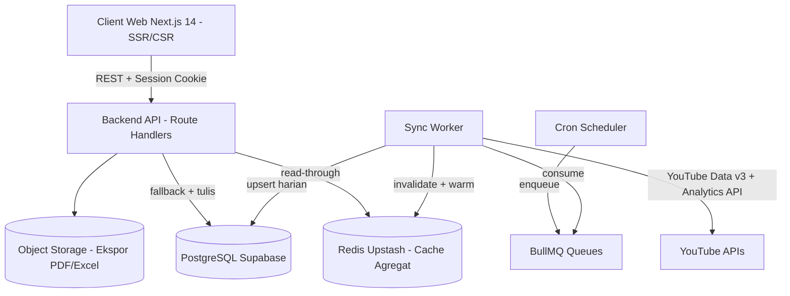

# System Design
## 1. Arsitektur Logis

## 2. Komponen dan Tanggung Jawab
### 2.1 Client Web Next.js
- Merender dashboard, grafik pertumbuhan, tabel video 50 baris per halaman dengan SSR untuk first paint dan CSR untuk interaksi filter tanggal, ganti channel, sortir.
- Memanggil Backend API via `fetch` internal dengan sesi NextAuth, tidak memanggil YouTube API langsung dari browser.
- Menyimpan state UI: `selectedChannelId`, `dateRange`, `compareMode`; cache client ringan via React Query/SWR 60 detik.
### 2.2 Backend API (Next.js Route Handlers)
- Modul `auth`: callback OAuth, pilih channel, revoke dan hapus data.
- Modul `sync-service`: validasi kepemilikan channel, enqueue sinkronisasi awal/ulang, kembalikan status sinkronisasi + `lastSyncedAt`.
- Modul `analytics-service`: melayani overview, growth, compare, dan video stats hanya dari PostgreSQL/Redis, tidak hit YouTube secara sinkron.
- Modul `report-service`: generate file ekspor ke object storage dan kembalikan signed URL.
- Semua handler menerapkan validasi `userId + channelId` per request.
### 2.3 Sync Worker + Scheduler (BullMQ + Redis)
- Scheduler: cron per channel tiap 2-6 jam dan sinkronisasi awal 90 hari saat channel baru ditambahkan.
- Worker: menarik Data API untuk metadata video/channel dan Analytics API untuk metrik harian, lalu agregasi menjadi `ChannelDailyStats` dan `VideoDailyStats`.
- Menulis ke PostgreSQL lalu warming/invalidasi cache Redis agar dashboard <3 detik.
### 2.4 Penyimpanan
- PostgreSQL: sumber kebenaran untuk Users, OAuthTokens terenkripsi, Channels, agregat harian, Videos, Reports/AIInsights.
- Redis: cache dashboard per kunci `dash:{channelId}:{from}:{to}:{metric}` TTL 15-60 menit dan lock antrean BullMQ.
- Object Storage: menyimpan hasil ekspor PDF/Excel sementara dengan retensi 7 hari.
## 3. Alur Komunikasi Utama
### 3.1 Hubungkan Channel dan Sinkronisasi Awal
1. `Browser -> API`: `POST /channels/select` dengan `youtubeChannelId`.
2. `API -> PG`: simpan Channel status `pending`, `API -> Queue`: enqueue `sync-initial {userId, channelId}` prioritas tinggi.
3. `Worker -> YT`: tarik channel info, daftar video, lalu Analytics 90 hari dengan paging dan backoff kuota.
4. `Worker -> PG/Redis`: upsert agregat, set status `ready`, tulis `lastSyncedAt`.
5. `Browser` polling `GET /channels` hingga status `ready` lalu fetch overview dari cache.
### 3.2 Baca Dashboard (Read-Through Cache)
1. `Browser -> API`: `GET /analytics/overview?channelId&from&to` dengan cookie sesi.
2. `API`: cek sesi, cek kepemilikan channel milik user, cek `Redis`.
3. Hit: kembalikan langsung. Miss: baca `PG`, agregasi di memori, tulis ke `Redis`, kembalikan. Tidak memicu hit YouTube sinkron.
4. Jika data `stale` melebihi interval sinkronisasi, `API` enqueue `sync-incremental` non-blokir dan tetap kembalikan data lama + header `X-Data-Stale: true`.
## 4. Struktur Folder dan Modul yang Disarankan
```text
/app
  /(auth)/login/page.tsx
  /(app)/dashboard/page.tsx
  /(app)/videos/[id]/page.tsx
  /api/auth/[...nextauth]/route.ts
  /api/channels/route.ts
  /api/analytics/overview/route.ts
  /api/analytics/growth/route.ts
  /api/analytics/compare/route.ts
  /api/videos/route.ts
/lib
  /auth/options.ts middleware.ts
  /db/prisma.ts schema.prisma
  /youtube/client.ts quota.ts mapper.ts
  /cache/keys.ts dashboard-cache.ts
  /queue/queues.ts workers.ts scheduler.ts
/components/dashboard/ MetricCard.tsx GrowthChart.tsx CompareBar.tsx
/components/videos/ VideoTable.tsx VideoDetail.tsx
```
- Aturan dependensi: `app/api/*` hanya boleh impor dari `lib/*`, dilarang impor langsung antar route; logika YouTube terisolasi di `lib/youtube/`.
## 5. Autentikasi dan Otorisasi
- Autentikasi: NextAuth.js Google Provider dengan scope minimal `youtube.readonly` + `userinfo.email`; sesi JWT httpOnly secure cookie, HTTPS wajib.
- Token: `access_token` di memori worker, `refresh_token` disimpan di `OAuthTokens` terenkripsi AES-256-GCM via KMS/env key, rotasi otomatis saat expired.
- Otorisasi: middleware sesi di semua `/api/*` kecuali callback; helper `requireChannelOwnership(userId, channelId)` cek relasi User-Channels sebelum query; isolasi multi-channel via filter `where: {userId, channelId}` di Prisma.
- Revoke: saat `DELETE /channels/:id` atau callback revoke Google, hapus token dan antrean terkait, tandai data untuk penghapusan sesuai ToS.
## 6. Penanganan Error dan Ketahanan Kuota
- Kategori error API: `401` sesi habis, `403` bukan pemilik channel, `404` channel/video tidak ada, `429/quotaExceeded` kuota YouTube habis, `5xx` gagal worker/DB.
- Format error standar: `{ error: { code, message, traceId, retryAfter } }`; log `traceId` tanpa PII/token.
- Strategi YouTube: exponential backoff + jitter untuk `403 quotaExceeded/429`, circuit breaker per channel 30 menit, batching harian bukan per-jam untuk hemat kuota.
- Strategi DB/Cache: timeout Prisma 5 detik, retry 1x untuk idempoten GET; jika Redis down, fallback langsung ke PG dan tandai `X-Cache: bypass`.
- UX: tampilkan banner `Data per {lastSyncedAt} - sinkronisasi berikutnya {nextRun}` dan state kosong `Belum ada data` saat sync `pending`.
## 7. Pekerjaan Background
- Queue `sync-initial`: concurrency 2, attempts 3, backoff 60s; memproses 90 hari pertama.
- Queue `sync-incremental`: cron `0 */4 * * *`, concurrency 5 untuk 1.000 channel MVP; hanya tarik delta `since lastSyncedAt`.
- Queue `report-export`: timeout 120 detik, upload ke object storage, kirim signed URL via API polling.
- Scheduler dan worker berjalan sebagai proses terpisah dari web (Vercel Cron + worker Node di VPS/Render/Fly) berbagi Redis Upstash yang sama; gunakan BullMQ `repeatable` + `deduplicationId per channel per hari` agar tidak dobel tarik.